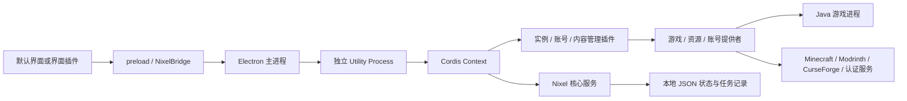

# 运行结构

主进程持有窗口、系统对话框与 `safeStorage`，验证 IPC 的窗口和顶层文档来源。渲染端保持 context isolation、sandbox，关闭 Node integration。Host 通过内部消息调用系统凭据服务，凭据不进入界面快照。

Host 的 `NixelService` 提供持久化状态、命令注册、提供者注册、任务与状态订阅。业务插件通过 Cordis `inject` 获取服务，通过插件作用域维护生命周期。JSON 写入使用串行队列和同目录临时文件替换，成功后广播新状态。重启时把中断的任务记录为失败，保留错误信息供用户重新发起操作。

通用管理插件负责实例身份、账号记录、内容文件与命令入口；具体提供者负责下载、鉴权和启动。实例保存独立目录、版本、加载器、账号、Java、内存、提供者 ID 与配置。内存以 MiB 保存，`null` 继承全局配置。浏览中的实例和主页待启动实例分别保存，避免管理操作改变启动选择。

默认界面复用已批准的 `design/` 原型。全局背景与磨砂层连续，内容页原地切换已安装与添加目录，安装目标跟随当前实例。全局资源页独立浏览，在安装对话框中选择目标。任务、游戏进程与界面路由相互独立，切换页面保留后台操作。

资源浏览器默认同时查询已启用的来源，也支持单独筛选。内容管理插件通过 Cordis 注册表并行查询提供者，交错合并每个来源的当前页，并分别返回失败来源的提示；安装继续传递资源本身的明确来源。同一实例可安装多个来源的资源。服务配置由主进程在启动时读取 `.env`，Host 私有模块缓存 Microsoft 客户端 ID、CurseForge Key 和可选 Modrinth Token 后移除其环境变量，避免传给 Java 子进程。配置不进入持久化设置或界面快照。

Minecraft 安装与启动由 Nixel 游戏提供者实现，版本清单来自 Mojang，Fabric/Quilt 配置来自各自 Meta API，Forge/NeoForge 从官方 Maven 获取安装器并执行其客户端处理器。Modrinth 资源直接请求其[公开 API](https://docs.modrinth.com/api/)，CurseForge 使用带自有 Key 的[官方 REST API](https://docs.curseforge.com/rest-api/)。Microsoft 设备代码登录需要项目自己的公开客户端 ID，按[设备授权流程](https://learn.microsoft.com/en-us/entra/identity-platform/v2-oauth2-device-code)获取授权，再通过 Xbox、XSTS 和 Minecraft 服务交换游戏会话。第三方账号直接请求 Yggdrasil 接口。

游戏提供者使用 `minecraft-version.ts` 解析版本继承、平台规则和 Maven 坐标，`minecraft-engine.ts` 编排安装，`forge-installer.ts` 处理加载器安装配置，`minecraft-launch.ts` 构造 JVM/游戏参数并启动进程。`java.ts` 读取官方 Java 清单；`install-files.ts` 负责并发、取消和文件校验。`authentication.ts` 与 `modrinth-client.ts` 为对应提供者的协议模块。ZIP 使用通用包 `yauzl`/`yazl`，这些模块均属于业务插件层。
