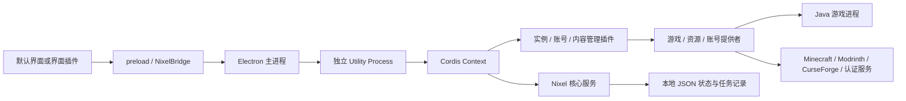

# 运行结构

主进程持有窗口、系统对话框与 `safeStorage`，验证 IPC 的窗口和顶层文档来源。渲染端保持 context isolation、sandbox，关闭 Node integration。Host 通过内部消息调用系统凭据服务，凭据不进入界面快照。

Host 的 `NixelService` 提供持久化状态、命令注册、提供者注册、任务与状态订阅。业务插件通过 Cordis `inject` 获取服务，通过插件作用域维护生命周期。JSON 写入使用串行队列和同目录临时文件替换，成功后广播新状态。重启时把中断的任务记录为失败，保留错误信息供用户重新发起操作。

通用管理插件负责实例身份、账号记录、内容文件与命令入口；具体提供者负责下载、鉴权和启动。实例保存独立目录、版本、加载器、账号、Java、内存、提供者 ID 与配置。内存以 MiB 保存，`null` 继承全局配置。浏览中的实例和主页待启动实例分别保存，避免管理操作改变启动选择。

默认界面复用已批准的 `design/` 原型。全局背景与磨砂层连续，内容页原地切换已安装与添加目录，安装目标跟随当前实例。全局资源页独立浏览，在安装对话框中选择目标。任务、游戏进程与界面路由相互独立，切换页面保留后台操作。

资源浏览器默认同时查询已启用的来源，也支持单独筛选。内容管理插件通过 Cordis 注册表并行查询提供者，交错合并每个来源的当前页，并分别返回失败来源的提示；安装继续传递资源本身的明确来源。同一实例可安装多个来源的资源。服务配置由主进程在启动时读取 `.env`，Host 私有模块缓存 Microsoft 客户端 ID、CurseForge Key 和可选 Modrinth Token 后移除其环境变量，避免传给 Java 子进程。配置不进入持久化设置或界面快照。

Minecraft 安装与启动由 Nixel 游戏提供者实现，版本清单来自 Mojang，Fabric/Quilt 配置来自各自 Meta API，Forge/NeoForge 从官方 Maven 获取安装器并执行其客户端处理器。Modrinth 资源直接请求其[公开 API](https://docs.modrinth.com/api/)，CurseForge 使用带自有 Key 的[官方 REST API](https://docs.curseforge.com/rest-api/)。Microsoft 设备代码登录需要项目自己的公开客户端 ID，按[设备授权流程](https://learn.microsoft.com/en-us/entra/identity-platform/v2-oauth2-device-code)获取授权，再通过 Xbox、XSTS 和 Minecraft 服务交换游戏会话。第三方账号直接请求 Yggdrasil 接口。

游戏提供者使用 `minecraft-version.ts` 解析版本继承、平台规则和 Maven 坐标，`minecraft-engine.ts` 编排安装，`forge-installer.ts` 处理加载器安装配置，`minecraft-launch.ts` 构造 JVM/游戏参数并启动进程。`java.ts` 读取官方 Java 清单；`install-files.ts` 负责并发、取消和文件校验。`authentication.ts`、`modrinth/client.ts` 与 `curseforge/client.ts` 为对应提供者的协议模块。ZIP 使用通用包 `yauzl`/`yazl`，这些模块均属于业务插件层。

## 插件内部模块

业务插件按职责组织模块，入口负责注册。实例管理、游戏实现、内容管理与资源来源分别组织：

| 模块                                                                 | 职责                                                                                               |
| -------------------------------------------------------------------- | -------------------------------------------------------------------------------------------------- |
| `plugins/instances/index.ts`                                         | 组合实例命令、文件、导入与备份功能，绑定 Cordis 作用域                                             |
| `plugins/instances/manage.ts`、`install.ts`、`launch.ts`、`files.ts` | 分别处理实例配置与增删、安装任务、启动命令、文件与日志查询                                         |
| `plugins/instances/backups/index.ts`                                 | 注册备份命令、任务与操作占用规则                                                                   |
| `plugins/instances/backups/operations.ts`                            | 编排备份和恢复，提交实例与内容记录，清理未完成的新实例                                             |
| `plugins/instances/backups/repository.ts`                            | 备份目录、清单、历史列表与原子提交/删除                                                            |
| `plugins/instances/backups/archive.ts`                               | ZIP 文件读写、相对路径边界、进度与取消                                                             |
| `plugins/instances/versions/`                                        | `catalog.ts` 查询版本，`compatibility.ts` 检查内容，`plan.ts` 生成预览，`change.ts` 编排备份与安装 |
| `plugins/minecraft/index.ts`、`install.ts`、`processes.ts`           | 注册游戏提供者，协调版本安装，拥有游戏进程和停止/释放逻辑                                          |
| `plugins/java-commands.ts`、`java-selection.ts`、`java.ts`           | Java 命令、版本选择规则、运行时检测与安装                                                          |
| `plugins/instance-state.ts`、`task-progress.ts`、`launch-logs.ts`    | 内置模块共用的实例访问与占用规则、进度适配、脱敏日志                                               |
| `plugins/content/index.ts`、`commands.ts`、`import.ts`、`updates.ts` | 组合内容插件，管理本地文件、启用状态、导入与更新任务                                               |
| `plugins/catalog/commands.ts`                                        | 资源命令、双来源搜索合并、按明确来源分发详情与安装                                                 |
| `plugins/modrinth/`、`plugins/curseforge/`                           | 各来源独立的注册入口、API 客户端、查询、详情、安装、更新检查与协议规则                             |
| `plugins/providers.ts`                                               | 公开的提供者契约，包括资源详情及 CurseForge 整合包文件接口                                         |

这些模块通过已有 Host 契约和提供者接口协作。`instance-state.ts` 是共享业务模块，不导入具体插件；内容管理无需依赖 Minecraft 插件入口。备份属于实例管理插件，未增加平行注册表或 Host 业务逻辑。

`backups/retention.ts` 在自动备份提交后执行按实例数量清理。备份清单记录 `origin`，缺失该字段的旧备份按手动备份保留；删除锁由仓库持有，手动删除、清理和恢复共用同一占用规则。清理失败写入任务日志，已经提交的新备份保持可用。

备份先写入 `backups/.pending/<id>/`，归档与清单完成后整体重命名为正式目录。删除先移出正式目录，再清理文件；启动时清理未完成的暂存目录。恢复先校验归档，再创建带 `pendingOperation` 的新实例，解压完成后提交设置和资源记录。取消或失败清理这个新实例；进程中断沿用实例插件的下次启动清理机制。原实例和正式备份保持独立。

备份仓库由实例插件入口创建并初始化，手动备份、版本变更和整合包升级共享同一仓库。版本目录模块从启动命令中分离，支持按实例选择游戏提供者。`plan.ts` 校验目标，`compatibility.ts` 查询资源兼容性，`content-plan` 固定用户选择的保留、禁用和更新操作。`change.ts` 在任务占用下复核配置与实际文件指纹，创建备份、下载内容、安装游戏，再通过文件事务提交资源与新的版本选择。取消或失败回滚文件；中断或恢复失败保留错误状态与备份入口，已下载的游戏文件可供后续安装复用。

默认界面的 `renderer/src/instances/` 分别组织版本选择、兼容性确认与对话框状态，列表展示来源原文，状态与提示使用中英文目录。版本变更和已有的安装、资源任务共用 Host 的实例占用及取消机制。

资源来源目录的 `index.ts` 只组合提供者实现并注册到 Cordis。`client.ts` 请求 API，`catalog.ts` 处理搜索与兼容版本列表，`details.ts` 映射介绍、截图和版本依赖，`install.ts` 与 `updates.ts` 分别拥有安装和更新流程。内容管理依赖 `ResourceProvider`，整合包通过公开的 `CurseForgeResourceProvider` 契约调用批量文件能力，均不导入来源插件内部实现。

账号目录 `plugins/accounts/` 分别组织管理命令、离线、Microsoft、Yggdrasil 提供者及 Yggdrasil 协议客户端；稳定插件 ID 与 `AccountProvider` 契约保留。`shared.ts` 只复用账号持久化与提供者注册。多角色待选会话、过期计时器由 Yggdrasil 插件作用域拥有；界面在独立 `accounts/AccountDialog.tsx` 中协调登录、角色选择与返回启动确认。

默认界面的资源详情位于 `renderer/src/resources/`：对话框协调目标与版本选择，项目介绍/截图、版本说明/依赖、富文本渲染分别由独立组件负责。详情读取按来源、项目和版本区分，过期响应不覆盖当前选择；介绍或版本说明请求失败可以独立重试，安装仍使用兼容版本列表。Markdown 由 `marked` 解析，HTML 统一通过 `DOMPurify` 白名单清理；只保留网页链接与 HTTPS 图片，链接交给系统浏览器。

两个来源的 `dependencies.ts` 把各自协议映射为内容节点；共享业务模块 `resource-dependencies.ts` 解析版本固定、必需依赖、显式选择的直接可选依赖以及冲突，形成有序下载计划后调用 `resource-files.ts`。提供者各自拥有 API 客户端与协议适配，目录管理插件只通过 `ResourceProvider` 的可选依赖查询及安装接口调用，不访问来源内部模块。界面的可选勾选状态按来源、项目、资源版本与目标实例区分。

`nixel.servers` 拥有实例服务器列表和状态查询。`servers/status.ts` 实现 DNS SRV 与 TCP 状态协议，查询资源绑定插件及界面作用域。快速加入通过既有实例启动命令向 `GameProvider.launch` 传递可选 `GameLaunchOptions`；提供者声明 `server-join` 能力并生成本次启动参数。管理插件不依赖具体游戏启动实现，永久启动配置不因加入服务器改变。

`nixel.diagnostics` 按收集、脱敏、规则分析、归档拆分模块。收集器只读实例内白名单日志与最近失败启动任务，分析器接收脱敏文本并返回带证据的发现；导出通过 Host 任务服务完成。界面位于独立 `diagnostics/DiagnosticPanel.tsx`，契约与隐私边界见 [崩溃诊断](diagnostics.md)。

`nixel.network` 组合配置验证、凭据保存与 Undici 请求分发，复用全局标准 fetch。主进程提供 Electron Session 代理配置、系统路由解析及绑定端点的认证应答；Host 和 Chromium 采用同一配置，连接池绑定插件作用域。公开配置保存凭据引用，密码由系统安全存储管理，网络选择不进入各协议客户端，见 [网络连接](network.md) 与 [代理身份验证](proxy-authentication.md)。

`nixel.downloads` 拥有全局队列、传输、续传缓存与限速，按职责拆为五个模块。Host 提供通用任务控制和异步任务作用域，`files.download` 从当前作用域解析下载提供者；暂停保持安装调用栈和实例占用。各协议模块继续提交 URL、目标与哈希，复用网络插件的代理，见 [下载管理](downloads.md)。

下载插件的 `mirrors/` 模块按官方主机、路径和预期哈希映射用户选择的文件镜像，`request.ts` 统一校验每次重定向。源选择在进入传输前完成，续传缓存按实际 URL 区分；认证、API 元数据与其他资源提供者沿用原来源，见 [下载镜像](download-mirrors.md)。

`nixel.skins` 负责皮肤文件校验、资料请求生命周期与外观修改任务，通过 `AccountProvider.appearance` 调用账号提供者。Microsoft 模块沿用认证会话实现官方外观协议；渲染端只获得纹理与披风数据，按需加载 `skinview3d`。契约见 [皮肤与披风](skins.md)。

`plugins/modpacks/` 从原单文件拆为清单解析、文件暂存、基线捕获、三方差异、应用回滚和导入导出模块，由实例插件注册业务命令并复用备份仓库。在线包文件通过公开资源提供者接口获取，来源内部 API 不进入整合包模块。新版本先准备并比较，用户确认后备份、安装游戏、应用文件，再提交版本与基线，见 [整合包升级](modpack-upgrade.md)。

版本变更的 `content-plan` 模块通过公开 `ResourceProvider.planInstall`，按来源合并用户选中的版本与依赖；共享依赖解析器生成固定文件清单，`content-state` 记录实际文件指纹。版本变更与整合包升级共用 `file-transaction` 处理短暂的文件提交和回滚，各业务分别提交自己的元数据，见 [版本与内容联动更新](version-content.md)。

`nixel.plugin-distribution` 负责用户目录协议、预览和下载任务。Host 的 `plugin-management/` 分离清单/配置校验、依赖规则、受管目录与替换事务；本地和远程安装共用生命周期。更新使用不可变目录与持久化指针，短生命周期锁阻止并发启动任务，管理任务仅能排除真实所属任务，见 [插件分发](plugin-distribution.md)。

`nixel.app-updates` 负责启动器更新命令、自动检查偏好与任务。主进程的 `app-updates/` 按配置、平台适配、状态控制与停机交接分层，通过 `HostPlatform.appUpdates` 调用通用 `electron-updater`；远程 Session 复用网络插件配置。安装前使用 `TaskManager.whileIdle` 阻止新任务，主进程冻结业务请求、确认后停止 Host，再交给平台安装器，见 [启动器更新](application-updates.md)。

`main/application-log.ts` 负责有限大小的本地事件日志与快照状态比较。Host、插件和任务的状态记录保持在主进程，故障恢复页无需业务 Host 即可打开日志目录；事件字段不包含业务参数与凭据，见 [启动器运行日志](application-logs.md)。
